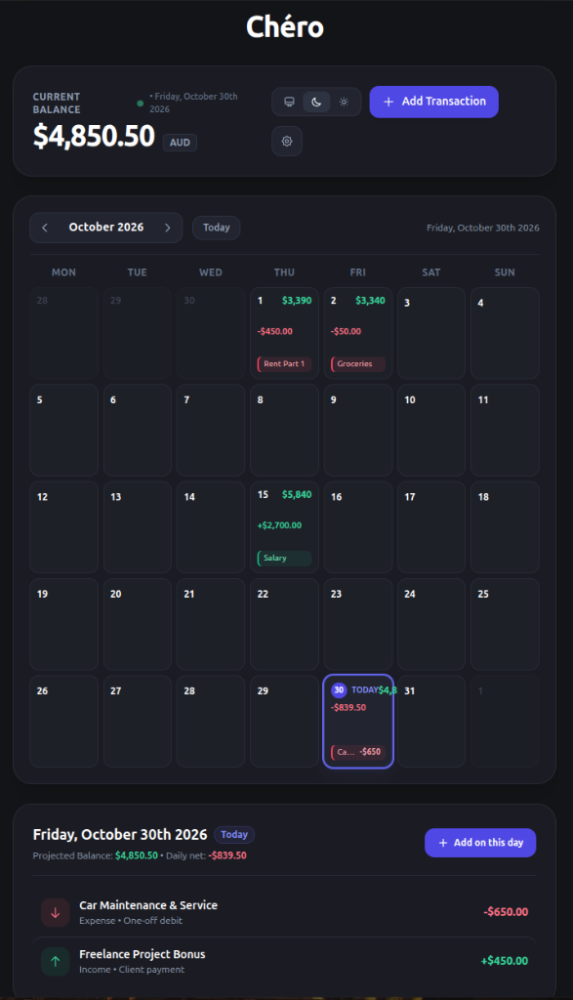

# Chéro - Budget in a Calendar

A web application for personal finance management with a calendar view.

<p align="center">
  
</p>

## Features

- **Languages supported**: English or French
- **Currency selection**: Choose your preferred currency in the settings.
- **Calendar View**: The week starts on Monday.
- **Swipe left/right**: modern calendar view navigation
- **Transactions**: Add one-time or recurring transactions (weekly, monthly) with custom intervals.
- **Daily Balance**: View your projected balance for each day of the calendar.
- **Balance adjustement**: Adjust the daily balance manually.
- **Dockerized**: Easy deployment with Docker.
- **Backup / Restore**: UI to back up and restore the DB (supports portable `.json` and legacy `.db` backups).
- **Android App & Offline-First Sync**: Native Android build via Capacitor with offline local storage, background sync outbox, and Cloudflare Zero Trust Service Token support.
- **Daily Reminder Notification**: Configurable daily push notification in Settings to remind you to enter daily transactions.


## How to launch

### With Docker

```bash
docker build -t chero .
docker run -p 3003:3003 chero
```

The application will be available at `http://localhost:3003`.

## Auto start docker container
```bash
docker update --restart always chero
```


### Local Development

1. **Backend**:
   ```bash
   cd backend
   npm install
   npx prisma migrate dev
   npm run dev
   ```

2. **Frontend**:
   ```bash
   cd frontend
   npm install
   npm run dev
   ```

The frontend will be on `http://localhost:3003` and the backend on `http://localhost:3003`.
The Vite proxy is configured to redirect `/api` calls to the backend.

### Android App (Capacitor)

1. **Sync web assets to Android project**:
   ```bash
   cd frontend
   npm run cap:sync
   ```

2. **Open in Android Studio or build APK**:
   ```bash
   cd frontend
   npm run android:open
   # Or build via Gradle CLI:
   cd android && ./gradlew assembleDebug
   ```

3. **Offline & Remote Server Sync (Cloudflare Zero Trust)**:
   - Leave **Server URL** empty in Settings for **100% standalone offline mode** on your phone.
   - To sync with a remote Chéro server protected by **Cloudflare Access (Google Sign-In)**:
     1. In Cloudflare Zero Trust Dashboard → *Access* → *Service Auth*, create a **Service Token** (`CF-Access-Client-Id` and `CF-Access-Client-Secret`) and attach a *Service Auth* policy to your Chéro application.
     2. In the Chéro Android app **Settings**, enter your **Server URL**, **CF Client ID**, and **CF Client Secret**.
     3. Transactions added or edited while offline are queued locally and synced automatically when online.
